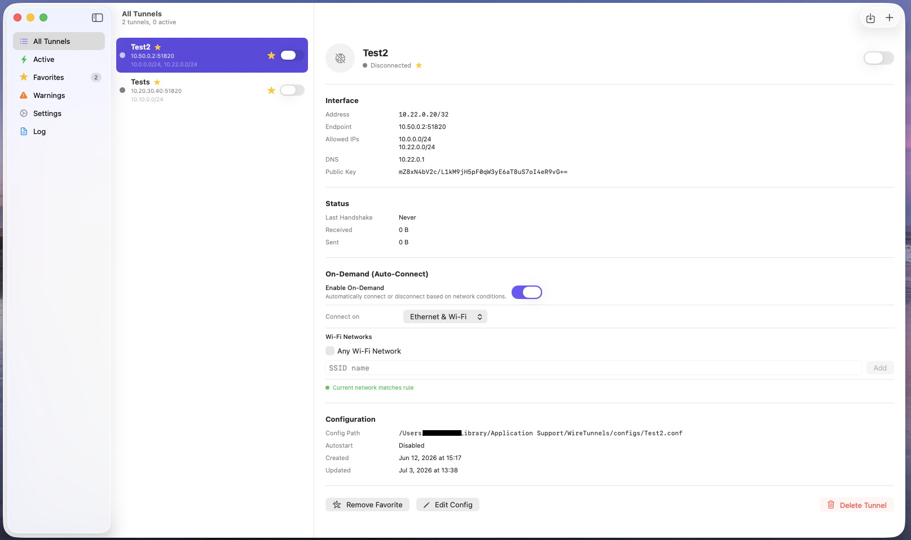
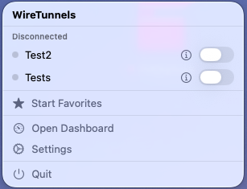
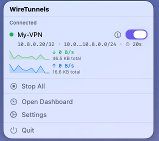
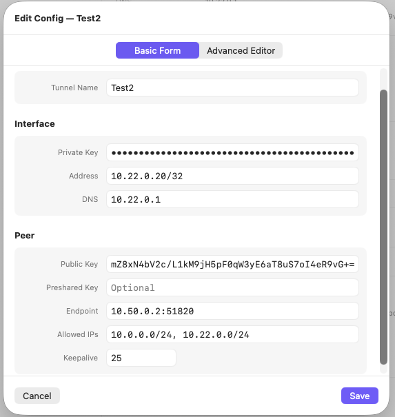
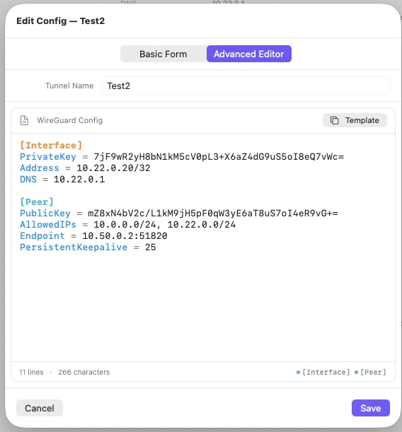
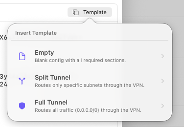
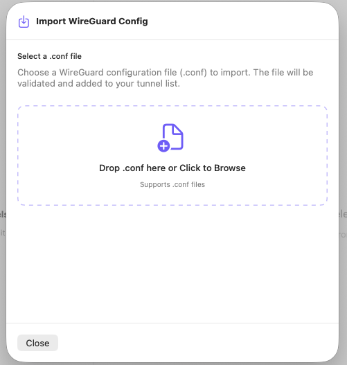
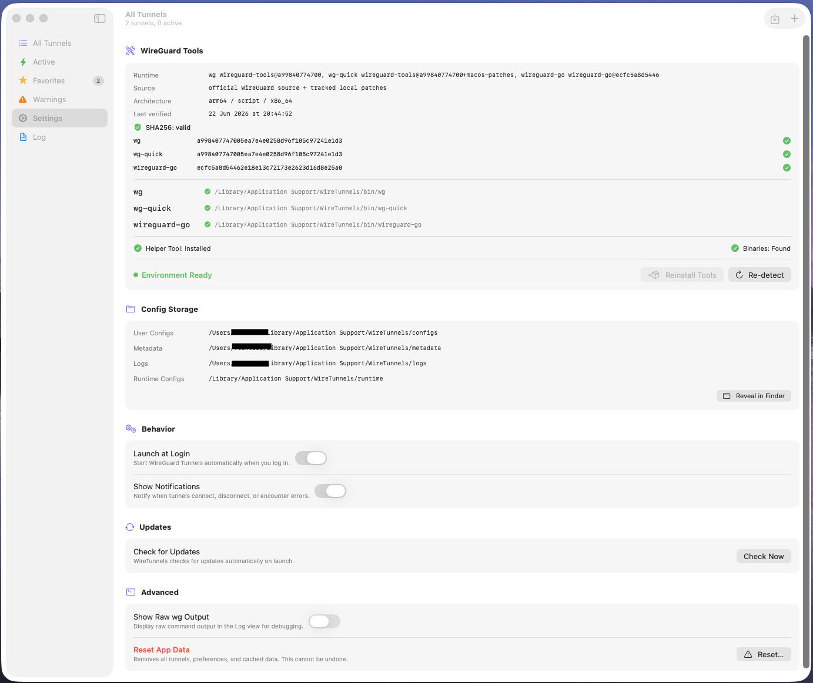
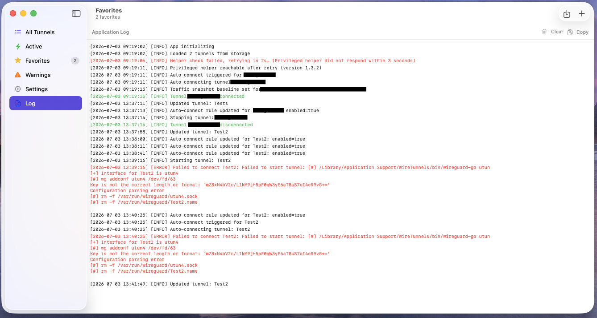

# WireTunnels

<p align="center">
  
</p>

<h3 align="center">
  Multi-tunnel WireGuard management for macOS.
</h3>

<p align="center">
  A native menu bar app built to connect, monitor and control multiple WireGuard tunnels without touching the terminal.
</p>

<p align="center">
  
  
  
  
</p>

<p align="center">
  <a href="#download">Download</a> ·
  <a href="#features">Features</a> ·
  <a href="#whats-new-in-106">What's new</a> ·
  <a href="#screenshots">Screenshots</a> ·
  <a href="#security--privacy">Security & Privacy</a> ·
  <a href="#installation">Installation</a> ·
  <a href="#license">License</a>
</p>

---

## The problem

WireGuard is fast, lightweight and reliable.
But on macOS, managing multiple active tunnels can quickly become uncomfortable.

You either use the official app with limited multi-tunnel flexibility, or you fall back to terminal commands, scripts and manual configuration files.

WireTunnels brings that workflow into a clean native macOS app.

---

## What WireTunnels does

WireTunnels lets you manage all your WireGuard tunnels from one place.

Use the menu bar for quick actions, open the dashboard for full visibility, import existing configurations, create new ones from templates, monitor live metrics and quickly understand route or DNS conflicts before they become a problem.

Beyond the basics, WireTunnels adds things the stock WireGuard tooling doesn't give you on macOS: **multi-hop chains**, a **kill switch**, **split DNS**, **runtime split-tunnel exclusions**, **tunnels shared across macOS users**, **Shortcuts/Siri automation** and **automatic recovery** after sleep, DHCP renewals and DDNS changes.

---

## Download

<p align="center">
  <strong>Ready to manage all your WireGuard tunnels from one native macOS app?</strong>
</p>

<p align="center">
  Download WireTunnels, move it to your Applications folder, import your tunnels and connect.
</p>

<p align="center">
  <a href="https://github.com/FMDigitech/WireTunnels/releases/latest">
    
  </a>
</p>

<p align="center">
  <a href="https://github.com/FMDigitech/WireTunnels/releases/latest">
    <strong>Get the latest release →</strong>
  </a>
</p>

WireTunnels is distributed as a signed and notarized macOS `.dmg` disk image, and updates itself through Sparkle.

```text
1. Download the latest release (.dmg)
2. Open the disk image
3. Drag WireTunnels.app to Applications
4. Open WireTunnels and approve the privileged helper when prompted
5. Import or create your tunnels
6. Connect from the menu bar
```

---

## Screenshots

<p align="center">
  
</p>

<table>
  <tr>
    <td align="center" width="50%">
      <br />
      <sub>Menu bar — disconnected</sub>
    </td>
    <td align="center" width="50%">
      <br />
      <sub>Menu bar — connected</sub>
    </td>
  </tr>
  <tr>
    <td align="center" width="50%">
      <br />
      <sub>Basic editor</sub>
    </td>
    <td align="center" width="50%">
      <br />
      <sub>Advanced editor</sub>
    </td>
  </tr>
  <tr>
    <td align="center" width="50%">
      <br />
      <sub>Templates</sub>
    </td>
    <td align="center" width="50%">
      <br />
      <sub>Import</sub>
    </td>
  </tr>
  <tr>
    <td align="center" width="50%">
      <br />
      <sub>Settings</sub>
    </td>
    <td align="center" width="50%">
      <br />
      <sub>Logs and errors</sub>
    </td>
  </tr>
</table>

---

## What's new in 1.0.7

* **Working kill switch** — enabling it now really blocks traffic outside the tunnel; its rules were previously never evaluated by the system firewall.
* **Security fix** — closed wg-quick hook filter bypasses that could run commands as root from a crafted configuration.
* **Inventory AllowedIPs** — a personal tunnel can run a local command after connecting and add the validated IPs/CIDRs it prints to its AllowedIPs and routes; they stay protected outside the VPN.
* **Search Domains** — a dedicated field for DNS search domains, applied while connected and restored on disconnect.
* **Duplicate tunnel**, **monochrome menu bar icon** and an **automatic update-check** setting.
* **Quieter recovery** — failed automatic reconnects stay in the log; the menu bar and menu show connecting, reconnecting or connection lost with *Retry* and *Details*.
* **Safer quit and DNS** — quitting waits for cleanup and restores DNS; DNS only changes on the active network and is repaired after an interrupted setup; sleep no longer triggers timeout errors.

Earlier highlights (1.0.x): split DNS, long tunnel names, shared tunnel access control, start in background, multi-hop chains, Shortcuts/Siri support, split-tunnel exclusions, throughput speed test, DHCP/sleep/DDNS auto-recovery, editable shared tunnels, notarized DMG distribution and in-app updates.

See [CHANGELOG.md](./CHANGELOG.md) for the full technical detail.

---

## Features

### Native macOS experience

A real macOS app: menu bar controller, desktop dashboard (All Tunnels, Active, Shared, Favorites, Multi-Hop, Warnings, Settings, Log), notifications, optional Dock icon hiding and start-in-background mode.

### Multi-tunnel control

Connect and disconnect multiple tunnels individually, all at once, or only your favorites.

### Built-in configuration workflow

Import existing `.conf` files or create new tunnels using the basic editor, advanced editor or ready-to-use templates. Tunnel names can be up to 50 characters.

### Live visibility

Monitor tunnel status, latest handshake, endpoint, interface, DNS, Allowed IPs, traffic usage and throughput sparklines in real time. A built-in connection test reports latency and, if you provide your own HTTPS URL, download throughput — no third-party host is ever contacted by default.

### Inventory AllowedIPs

Personal tunnels can run a local command after connecting to discover additional
IPs/CIDRs, append them to the static AllowedIPs, and install their routes. The last
successful inventory is cached; static and cached destinations remain protected
when disconnected. See [setup, Python example, and limitations](Scripts/INVENTORY.md).

### Multi-hop chains

Pair two personal tunnels so that one ("hop") is brought up first and the other ("exit") routes its WireGuard traffic through it: the exit server sees the hop's IP, not yours. Chains are connected and disconnected as a unit from the *Multi-Hop* section, and survive sleep/wake.

### Kill switch

Per-tunnel kill switch built on the macOS packet filter: if the tunnel drops, traffic is blocked instead of leaking over your regular connection. It is re-armed automatically after sleep and wake.

### Split DNS

Define per-tunnel domains whose lookups go to the tunnel's `DNS =` servers while all other queries keep using the system DNS. Implemented with `/etc/resolver/<domain>` files that WireTunnels marks as its own — resolver files it didn't create are never touched.

### Split-tunnel exclusions

Exclude specific CIDR ranges from a connected tunnel at runtime: that traffic goes out through your regular connection, with no config edit and no reconnect.

### On-demand automation

Launch WireTunnels automatically at login. Per-tunnel On-Demand rules connect **or disconnect** a tunnel automatically based on network conditions (Wi-Fi SSID, Ethernet, or both) — for example, drop a tunnel when you join a trusted Wi-Fi network. Rules are re-evaluated after sleep.

### Automatic recovery

WireTunnels notices when a tunnel is silently dead and restarts only what is affected:

* after the Mac wakes from sleep,
* after a DHCP lease renewal changes your local IP,
* when a peer behind DDNS / a dynamic IP changes address.

### Shortcuts, Siri and Raycast

App Intents let you connect or disconnect a tunnel, disconnect all, and query connected tunnels from Shortcuts, Siri or Raycast (via its *Run Shortcut* bridge). The app must be running for intents to act.

### Favorites and quick actions

Mark tunnels as favorites and quickly start or stop all favorite tunnels from the menu bar or with shortcuts.

### Managed shared tunnels

Administrators can create tunnels shared across every local user on the Mac. Shared tunnel configs and private keys are stored by the privileged helper with root-only permissions; standard users can see and use shared tunnels but never their keys. Administrators can edit shared tunnels, set Split DNS domains, and choose whether other users may connect and/or disconnect them. Personal tunnels remain private per user.

### Secure, verified WireGuard runtime

The privileged helper installs the WireGuard binaries itself, only from its own signed app bundle, and only after you approve the helper. It checks every tool against anchors compiled into the helper — the app's code signature for `wg` and `wireguard-go`, a build-time hash for `wg-quick` — and re-checks them right before each run. A tool that fails is replaced, and the event is logged. The helper also validates the calling app's signature, and an outdated helper is detected and replaced.

### Smarter warnings

WireTunnels helps identify common problems such as full-tunnel conflicts, overlapping routes and DNS inconsistencies.

### Updates

Signed updates are delivered through Sparkle (EdDSA-verified). WireTunnels checks on launch, and you can check manually from Settings.

---

## Security & Privacy

WireTunnels is designed to run locally on your Mac.

* Tunnel configurations are stored locally on your machine.
* WireTunnels does not require an account.
* WireTunnels does not collect analytics.
* WireTunnels does not send your VPN configurations to external servers.
* Private keys remain inside your local configuration files.
* Network status and tunnel metrics are read locally from WireGuard tooling.
* Privileged operations are handled only when required to start, stop or manage tunnels, and are validated by the helper (caller signature, input sanitization, root-only storage for shared tunnels).
* The only network request WireTunnels makes on its own is the update check against the public appcast; the optional speed test only uses a URL you provide.
* Private keys are redacted from any status output the helper returns to the app.

Always review imported WireGuard configuration files before connecting, especially if they were provided by third parties.

---

## Installation

**Requirements:** macOS 14 (Sonoma) or later.

1. Download the latest `.dmg` from the [Releases page](https://github.com/FMDigitech/WireTunnels/releases/latest).
2. Open the disk image and drag `WireTunnels.app` into the `Applications` folder.
3. Open the app from `Applications` (shared tunnels and the helper require running it from there).
4. Approve the privileged helper when prompted. It then installs the WireGuard tools bundled with the signed app by itself; there is no download.
5. Import or create your WireGuard tunnel configurations.
6. Connect your tunnels from the menu bar or dashboard.

Existing installs update automatically through the in-app updater (Settings → Updates).

---

## Status

WireTunnels is currently focused on WireGuard tunnel management for macOS.

Future versions may include additional diagnostics, improved routing analysis, better DNS conflict detection, per-app split tunneling and extended automation features.

---

## Support

For any request, information, or to report errors, write to:

```text
f.tontaro@fmdigitech.com
```

You can also open an issue on the project repository.

---

## License

WireTunnels is licensed under the Apache License 2.0.

---

## Disclaimer

WireTunnels is an independent project.
WireGuard is a registered trademark of Jason A. Donenfeld.

---

<p align="center">
  <sub>Built with care by</sub>
</p>

<p align="center">
  <a href="https://fmdigitech.com">
    
  </a>
</p>

<p align="center">
  <a href="https://fmdigitech.com"><strong>FMDigitech</strong></a>
</p>
