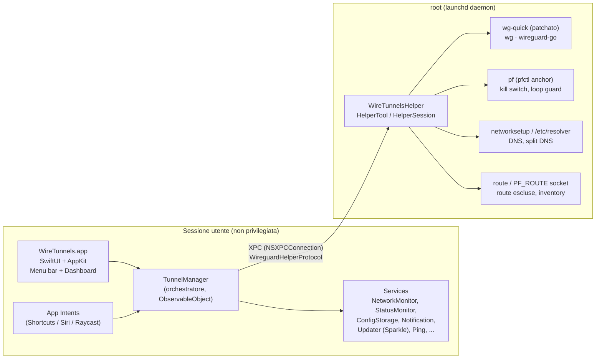
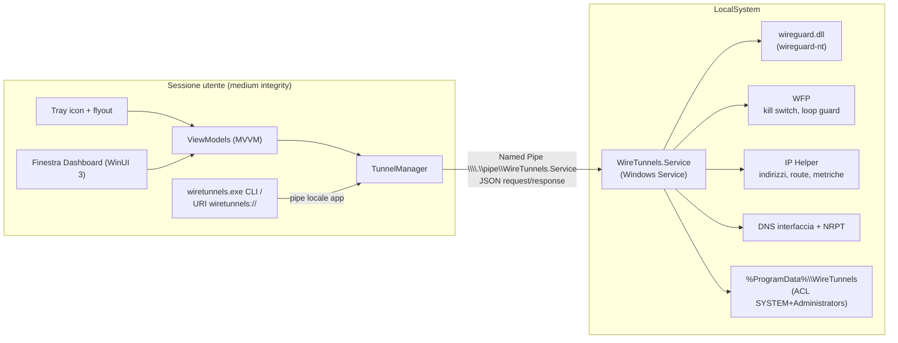
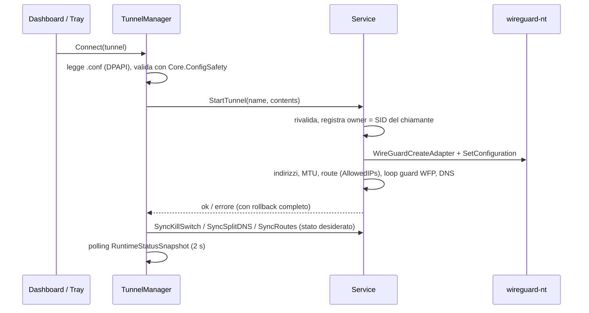

# WireTunnels per Windows — Architettura del porting nativo

> Stato: fasi 1–2 implementate in [`windows/`](../windows/README.md) (Core, Contracts, Service MVP, CLI) · Base: WireTunnels macOS 1.0.9 · Data: 2026-11-05

Questo documento descrive come è fatta oggi WireTunnels su macOS e come
ricostruirla su Windows con **linguaggio nativo e UI nativa Windows**, mantenendo
le stesse funzionalità, lo stesso modello di sicurezza (app non privilegiata +
servizio privilegiato) e lo stesso formato dati dove possibile.

Il codice Swift non è riutilizzabile su Windows: il porting è una **nuova codebase**.
La codebase macOS resta la specifica funzionale: modelli, regole di validazione,
casi limite e test descrivono il comportamento da replicare.

---

## 1. Architettura attuale (macOS)

WireTunnels su macOS è composta da due processi separati con privilegi diversi.



### 1.1 Processo app (`WireTunnels/`)

| Area | File principali | Ruolo |
|---|---|---|
| Entry point | `WireTunnelsApp.swift` | `MenuBarExtra` + finestra Dashboard + Settings; gestione quit sicuro (disconnette i tunnel prima di uscire) |
| Orchestratore | `Services/TunnelManager.swift` (~2500 righe) | Stato pubblicato verso la UI: lista tunnel, connessione/disconnessione, polling stato (2 s), warnings, kill switch, split DNS, route escluse, multi-hop, on-demand, wake/DHCP/DDNS recovery, shutdown |
| Client privilegiato | `Services/WireGuardCommandService.swift` | Registrazione helper (`SMAppService`), connessione XPC, timeout, autorizzazione admin (`AuthorizationRef`) |
| Persistenza | `ConfigStorageService`, `RecoverableJSONStore`, `TunnelRepository`, `HopChainRepository`, `AppPaths`, `AppMigration` | `.conf` per-utente + `tunnels.json` metadati, store JSON con recupero da corruzione, migrazione dai path legacy |
| Rete | `NetworkMonitorService`, `NetworkChangeScheduler`, `PhysicalNetworkSnapshot`, `AutoConnectNetworkMatcher`, `DefaultRouteService`, `RouteLookupService`, `InterfaceAddressCollector` | Cambi di rete (SCDynamicStore), SSID Wi-Fi (CoreWLAN / networksetup), wake, debounce, regole on-demand |
| Stato runtime | `StatusMonitorService`, `ThroughputProbeService`, `PingService` | Parsing `wg show all dump` (handshake, rx/tx), sparkline, test latenza/throughput |
| Logica pura | `Models/*`, `WireGuardConfigParser`, `IPSubnet`, `IPFamilyLeak`, `TunnelWarning`, `Shared/InventoryRouting.swift` | Modello `Tunnel`, regole on-demand, parser `.conf`, prefissi IP, rilevamento conflitti/leak |
| UI | `Views/MenuBar`, `Views/Dashboard`, `Views/Config`, `Views/Settings` | Menu bar, dashboard con sidebar (All, Active, Shared, Favorites, Multi-Hop, Warnings, Settings, Log), editor base/avanzato, template, import, setup wizard |
| Automazione | `Intents/*`, `AppIntentBridge` | Connect / Disconnect / Disconnect all / stato connessi |
| Update | `UpdaterService` | Sparkle con firma EdDSA, `appcast.xml` |

### 1.2 Processo helper (`WireTunnelsHelper/`, root)

- `HelperTool.swift`: listener XPC; valida la **firma del client** e l'UID chiamante.
- `HelperSession`: implementa `WireguardHelperProtocol` (≈27 operazioni, vedi §4).
- `ToolInstaller`: installa `wg`, `wg-quick`, `wireguard-go` dal bundle firmato in
  `/Library/Application Support/WireTunnels/bin`, verificandoli con anchor compilati
  (code signature / SHA-256) prima di ogni esecuzione.
- `CommandRunner`: esecuzione processi con timeout e progress parsing.
- `DNSRecoveryService`: ripristino DNS di sistema dopo crash/timeout di `wg-quick`.
- `InventoryRoutingService`, `InventoryRouteSocket`, `InventoryInterfaceMonitor`:
  route dinamiche "inventory" via socket `PF_ROUTE`.
- Store **managed** (tunnel condivisi tra utenti) in `/Library/Application Support/WireTunnels/managed`, root-only;
  le chiavi private non tornano mai all'app.

### 1.3 Invarianti da preservare

1. L'app non gira mai con privilegi elevati; ogni operazione di rete passa dal servizio.
2. Il servizio valida **chi** chiama (firma del binario + identità utente) e **cosa** chiede (nomi, CIDR, IP, porte, contenuto config).
3. I tunnel *managed* appartengono al servizio: utenti standard li usano secondo policy (`usersCanConnect`, `usersCanDisconnect`) ma non leggono le chiavi.
4. Un utente non può toccare route/tunnel di un altro utente (`ownerId`).
5. Nessuna chiamata di rete in uscita tranne il controllo aggiornamenti (e lo speed test su URL scelto dall'utente).
6. Quit e stop del servizio ripuliscono DNS, route e regole firewall: nessuno stato di rete orfano.

---

## 2. Scelte tecnologiche per Windows

| Livello | Scelta raccomandata | Motivo |
|---|---|---|
| Linguaggio | **C# / .NET 8 LTS** (o successiva LTS) | Nativo per Windows, P/Invoke diretto su Win32 (IP Helper, WFP, WLAN, NRPT), async/await simile al modello Swift attuale, tooling e test maturi |
| UI | **WinUI 3 (Windows App SDK)** | UI nativa Fluent di Windows 11; equivalente di SwiftUI (XAML + MVVM con `CommunityToolkit.Mvvm`) |
| Tray icon | `H.NotifyIcon.WinUI` (o `Shell_NotifyIcon` via P/Invoke) | WinUI 3 non ha tray nativa; equivale a `MenuBarExtra` |
| Motore WireGuard | **wireguard-nt** (`wireguard.dll`, driver kernel ufficiale) | Equivalente di `wireguard-go` ma in kernel; API C per creare adapter, impostare config, leggere statistiche. Più tunnel simultanei = più adapter |
| Processo privilegiato | **Windows Service** (`LocalSystem`) con .NET Worker Service | Equivalente del daemon launchd |
| IPC | **Named Pipe** con ACL + impersonation del client | Equivalente di XPC; permette di identificare SID/sessione e PID del chiamante |
| Kill switch / loop guard | **Windows Filtering Platform (WFP)**, sublayer dedicato | Equivalente dell'anchor `pf` |
| Route | **IP Helper API** (`CreateIpForwardEntry2`, `DeleteIpForwardEntry2`, `GetBestRoute2`) | Equivalente di `route` / `PF_ROUTE` |
| DNS | DNS per interfaccia (`SetInterfaceDnsSettings`) + **NRPT** per split DNS | Equivalente di `networksetup` e `/etc/resolver` |
| Cambi di rete | `NotifyIpInterfaceChange`, `NotifyRouteChange2`, `NotifyUnicastIpAddressChange`, `NetworkInformation.NetworkStatusChanged` | Equivalente di SCDynamicStore / NWPathMonitor |
| SSID Wi-Fi | **Native Wifi API** (`WlanOpenHandle`, `WlanQueryInterface`) | Equivalente di CoreWLAN. Su Windows 11 24H2+ richiede il consenso alla posizione: gestirlo come oggi su macOS |
| Sleep/wake | `PowerModeChanged` / `RegisterSuspendResumeNotification` | Equivalente di `NSWorkspace.didWakeNotification` |
| Notifiche | `AppNotificationManager` (Windows App SDK) | Toast nativi |
| Avvio al login | chiave `HKCU\...\Run` (MSI) o `StartupTask` (MSIX) | Equivalente di `SMAppService.mainApp` |
| Aggiornamenti | **NetSparkleUpdater** (appcast + firma Ed25519) + verifica Authenticode dell'installer | Riusa il formato `appcast.xml` e la firma EdDSA già in uso con Sparkle |
| Installer | **MSI (WiX Toolset)** firmato | Deve installare il servizio e il driver: richiede elevazione una volta, come l'approvazione dell'helper su macOS |
| Grafici | Sparkline semplice con `Polyline` XAML | Evita una libreria di grafici per una sparkline |
| QR code | `QRCoder` | Equivalente di CoreImage |

**Alternativa C++/WinRT**: possibile e "più nativa", ma il costo di sviluppo è molto
più alto (gestione memoria, stringhe, async) senza benefici concreti per un'app di
questo tipo. Il servizio può restare in C# e chiamare le API Win32 via P/Invoke
generato con `CsWin32`.

---

## 3. Architettura Windows proposta



### 3.1 Struttura della solution

```text
WireTunnels.Windows.sln
├─ src/
│  ├─ WireTunnels.Core/          # net8.0, nessuna dipendenza Windows
│  │   Models/        Tunnel, AutoConnectRule, HopChain, ManagedTunnelPolicy, SystemSettings, TunnelWarning
│  │   Config/        WireGuardConfigParser, ConfigSafety (validazione condivisa app/servizio)
│  │   Net/           IPPrefix, IPSubnet, IPFamilyLeak detector, AutoConnectNetworkMatcher
│  │   Storage/       RecoverableJsonStore, TunnelRepository, HopChainRepository
│  ├─ WireTunnels.Contracts/     # DTO IPC + ProtocolRevision (referenziato da app e servizio)
│  ├─ WireTunnels.Service/       # Windows Service, LocalSystem
│  │   Ipc/           PipeServer, ClientValidator (SID, sessione, Authenticode del client)
│  │   WireGuard/     WireGuardNative (P/Invoke), TunnelRunner (equivalente di wg-quick)
│  │   Network/       RouteService, DnsService, NrptService, FirewallService (WFP), InventoryRouting
│  │   Managed/       ManagedStore, ConnectedUsersStore, SystemSettingsStore
│  │   Recovery/      StateJournal (ripristino DNS/route/WFP dopo crash)
│  ├─ WireTunnels.App/           # WinUI 3
│  │   Views/         Tray, Dashboard (NavigationView), Config, Settings, SetupWizard
│  │   ViewModels/
│  │   Services/      TunnelManager, ServiceClient, NetworkMonitor, StatusMonitor,
│  │                  NotificationService, UpdaterService, StartupService, LogService
│  └─ WireTunnels.Cli/           # connect/disconnect/status per automazione
├─ tests/
│  ├─ WireTunnels.Core.Tests/    # xUnit: parser, validazione, matcher, IPPrefix, store
│  └─ WireTunnels.Service.Tests/ # xUnit: validazione richieste, access control, regole WFP
└─ installer/                    # WiX: MSI, servizio, wireguard.dll, firma
```

`WireTunnels.Core` è il punto più importante: la logica pura oggi sparsa in
`Models/`, `WireGuardConfigParser`, `IPSubnet`, `Shared/InventoryRouting.swift` e
nelle validazioni di `HelperTool` va scritta **una volta** e usata sia dall'app sia
dal servizio, così le due parti non divergono (su macOS alcuni tipi sono duplicati
tra app e helper, es. `ManagedTunnelPolicy`, `SplitDNSEntry`, `RouteEntry`, `SystemSettings`).

### 3.2 Mappatura componenti macOS → Windows

| macOS | Windows |
|---|---|
| `WireTunnelsApp` (`MenuBarExtra`, `Window`, `NSApplicationDelegate`) | `App.xaml.cs` (istanza singola via `AppInstance`), tray + `DashboardWindow`; quit sicuro con dialog Retry / Cancel |
| `TunnelManager` (`ObservableObject`, `@MainActor`) | `TunnelManager` con `ObservableObject` di CommunityToolkit, aggiornamenti sul `DispatcherQueue` UI |
| `WireGuardCommandService` + XPC | `ServiceClient`: pipe, timeout per operazione, retry, verifica `ProtocolRevision` |
| `SMAppService.daemon` + approvazione in Impostazioni | Servizio installato dall'MSI; l'app verifica che sia in esecuzione e che la versione coincida (equivalente di `helperNeedsReplacement`) |
| `AuthorizationRef` per operazioni admin | Il servizio controlla il token del client impersonato: deve appartenere a `BUILTIN\Administrators` **ed essere elevato**. Per le operazioni admin l'app avvia un piccolo processo elevato (UAC), che si connette alla pipe con token elevato |
| `ToolInstaller` + anchor firma/SHA-256 | Verifica Authenticode di `wireguard.dll` (`WinVerifyTrust` + certificato del firmatario pinnato) prima del caricamento; la DLL sta in `%ProgramFiles%\WireTunnels` (scrivibile solo da admin) |
| `wg-quick up/down` (bash patchato) | `TunnelRunner` nel servizio: crea adapter, assegna indirizzi, imposta MTU, route, DNS, loop guard; rollback se un passo fallisce |
| `wg show all dump` | `WireGuardGetConfiguration` (handshake, rx/tx, endpoint per peer) |
| `pfctl -a anchor` | Filtri WFP in un sublayer con GUID fisso, sessione dinamica + filtri persistenti solo per il kill switch armato |
| `/etc/resolver/<domain>` | Regole NRPT con marker WireTunnels, rimosse solo se nostre (equivale a `ResolverStore.isOurs`) |
| `networksetup -setdnsservers` + `DNSRecoveryService` | DNS sull'interfaccia del tunnel + metrica interfaccia bassa; il DNS sparisce con l'adapter, quindi nessuno stato orfano dopo un crash |
| `PF_ROUTE` socket / `InventoryInterfaceMonitor` | `NotifyRouteChange2` / `NotifyIpInterfaceChange` |
| `SCDynamicStore`, `NSWorkspace.didWake` | `NotifyUnicastIpAddressChange`, `NetworkStatusChanged`, `PowerModeChanged` |
| CoreWLAN / `networksetup -getairportnetwork` | `WlanQueryInterface(wlan_intf_opcode_current_connection)` |
| App Intents (Shortcuts, Siri, Raycast) | CLI `wiretunnels.exe connect|disconnect|disconnect-all|status` + URI `wiretunnels://`: utilizzabile da PowerToys Run, Raycast per Windows, Task Scheduler, script |
| `UNUserNotificationCenter` | `AppNotificationManager` |
| Sparkle | NetSparkleUpdater: stesso formato appcast (canale Windows separato) e firma Ed25519; installer MSI verificato anche via Authenticode |
| `~/Library/Application Support/WireTunnels` | `%LOCALAPPDATA%\WireTunnels` (`configs\`, `metadata\tunnels.json`, `logs\`) |
| `/Library/Application Support/WireTunnels` (root-only) | `%ProgramData%\WireTunnels` con ACL `SYSTEM` + `Administrators`, nessun accesso a `Users` |
| `UserDefaults` | `settings.json` in `%LOCALAPPDATA%\WireTunnels` |
| `OSLog` + `LogService` | `LogService` su file con rotazione; servizio su file in `%ProgramData%\WireTunnels\logs` + Event Log per errori gravi |

---

## 4. Contratto IPC (app ↔ servizio)

Trasporto: named pipe `\\.\pipe\WireTunnels.Service`, messaggi JSON con
prefisso di lunghezza (4 byte), una richiesta → una risposta, con `requestId`.
Il formato `{ ok, error, data }` replica i `reply(Bool, String?)` / `reply(Data?, String?)` di XPC.

**ACL della pipe**: `SYSTEM` full, `Authenticated Users` read/write, nessun accesso
remoto (`PIPE_REJECT_REMOTE_CLIENTS`). Il servizio crea la pipe con
`FILE_FLAG_FIRST_PIPE_INSTANCE` per evitare che un altro processo la occupi prima (pipe squatting).

**Validazione del client** (equivalente di `ValidatedClient`):
1. `GetNamedPipeClientProcessId` → path dell'immagine → `WinVerifyTrust` e confronto del certificato con quello di WireTunnels.
2. `ImpersonateNamedPipeClient` → SID utente, Session ID, appartenenza ad Administrators ed elevazione.
3. Il SID sostituisce l'UID macOS come `ownerId` per route e tunnel personali.

Operazioni (stessi nomi semantici di `WireguardHelperProtocol`):

| Gruppo | Operazioni | Note Windows |
|---|---|---|
| Ciclo di vita tunnel | `StartTunnel(name, contents)`, `StopTunnel(name)` | La config viaggia in memoria fino a wireguard-nt: il servizio non scrive chiavi private su disco e non accetta path dal client. Niente `StageConfig`: su macOS serviva solo perché `wg-quick` legge un file |
| Stato | `RuntimeStatusSnapshot`, `CommandDiagnostics` | Le chiavi private e le preshared key vengono rimosse prima di rispondere; un utente vede solo i tunnel che ha avviato, un admin elevato tutti |
| Rete | `SyncKillSwitch(entries)`, `SyncSplitDNS(entries)`, `SyncRoutes(ownerId, entries)`, `UpdateInventoryRouting(request)`, `RecoverDNSState` | Operazioni dichiarative e idempotenti: il client invia lo stato desiderato completo, il servizio calcola il diff |
| Managed | `ListManagedTunnels`, `ReadManagedConfig`, `InstallManagedTunnel`, `UpdateManagedTunnel`, `DeleteManagedTunnel`, `StageManagedConfig`, `MarkManagedTunnelConnected/Disconnected`, `ListManagedTunnelUsers` | Le scritture e `ReadManagedConfig` richiedono un token admin elevato |
| Sistema | `GetSystemSettings`, `SetSystemSettings`, `ToolStatus`, `ServiceVersion`, `ProtocolRevision` | `ProtocolRevision` blocca app e servizio di versioni incompatibili |
| Chiavi | — | Generate nell'app (`Core.WireGuardKey`, X25519 di BouncyCastle): non serve un'operazione privilegiata |

Con l'impersonation, il campo `authorization: Data` del protocollo macOS non serve
più: l'autorizzazione è il token stesso della connessione.

---

## 5. Flussi principali

### 5.1 Connessione di un tunnel personale



`TunnelRunner` sostituisce `wg-quick`. Deve replicare anche le correzioni già fatte su
macOS (`Scripts/wg-quick-*.patch`): pulizia DNS su errore, recupero DNS dopo
crash, loop guard e cleanup completo. Le direttive `PreUp/PostUp/PreDown/PostDown`
sono **rifiutate** come su macOS (eseguirebbero comandi come SYSTEM), sia all'import
sia nel servizio. L'unico comando eseguito resta "Inventory AllowedIPs", lanciato
dall'app nel contesto dell'utente, come oggi.

### 5.2 Tunnel condivisi (managed)

Uguale a macOS: config e metadati in `%ProgramData%\WireTunnels\managed`, scritti
solo dal servizio. Gli utenti standard ricevono metadati sanificati (senza chiavi).
Il servizio registra quali SID e sessioni sono connessi (`ConnectedUsersStore`) e
applica `usersCanConnect` / `usersCanDisconnect`. Con il cambio rapido utente di
Windows più sessioni possono essere attive insieme, come più utenti su macOS.

### 5.3 Kill switch (WFP)

Per ogni tunnel armato, nel sublayer WireTunnels:
- permit: traffico sull'adapter del tunnel (per LUID);
- permit: UDP verso `endpoint:porta` del peer dall'interfaccia fisica;
- permit: loopback, DHCP, NDP/ICMPv6 essenziale;
- block: tutto il resto IPv4/IPv6, con peso inferiore.

Il kill switch **armato** usa filtri persistenti, così resta attivo anche se il
servizio crasha. Gli altri filtri (loop guard) usano una sessione WFP
dinamica, che si pulisce da sola quando il servizio si chiude. Questo riproduce il
comportamento "il tunnel è caduto, il kill switch blocca" (`TunnelWarning.killSwitchBlocking`).

### 5.4 DNS e split DNS

- DNS completo: server DNS impostati sull'adapter del tunnel + metrica interfaccia
  bassa; con tunnel full-route, regole WFP che bloccano la porta 53 sulle altre
  interfacce (Windows interroga più interfacce in parallelo, quindi senza blocco c'è DNS leak).
- Split DNS: una regola NRPT per dominio (`.dominio` → server del tunnel), marcata
  come WireTunnels e rimossa allo stop o al ripristino.
- Recovery: DNS, indirizzi e route del tunnel appartengono all'adapter wireguard-nt, che
  sparisce quando il servizio chiude l'handle o termina (anche per crash): per questi non
  serve un journal. Il journal in `%ProgramData%\WireTunnels\state` serve solo per lo stato
  che vive fuori dall'adapter (regole NRPT, filtri WFP persistenti) e arriva con la fase 4.

### 5.5 Multi-hop, route escluse, recovery

- **Multi-hop**: host route `/32` o `/128` dell'endpoint del tunnel di uscita sul LUID
  dell'adapter hop (`CreateIpForwardEntry2`), poi avvio del tunnel di uscita.
- **Route escluse**: route più specifiche verso il gateway fisico pre-VPN
  (`GetBestRoute2` sull'interfaccia fisica), con `ownerId` = SID.
- **Wake / DHCP / DDNS**: `NetworkMonitor` nell'app usa un debounce (ruolo di
  `NetworkChangeScheduler`) e richiama la stessa logica di
  `TunnelManager.handleSystemWake / handleLocalAddressChange / checkEndpointReResolution`;
  quando l'endpoint si risolve su un nuovo IP, il peer viene aggiornato con
  `WireGuardSetConfiguration` senza ricreare l'adapter.

### 5.6 Avvio e shutdown

- Avvio app: migrazione dati → lettura metadati → verifica servizio e versione →
  caricamento tunnel managed → valutazione regole on-demand → autostart.
- Quit app: `prepareForQuit` come su macOS (disconnette, ripristina la rete,
  dialog Retry / Cancel se fallisce).
- Logoff/shutdown di Windows: il servizio riceve `SERVICE_CONTROL_SESSIONCHANGE`
  e `PRESHUTDOWN`, ferma i tunnel personali della sessione che si chiude e pulisce
  route e DNS. I tunnel managed seguono la loro policy.

---

## 6. Dati e persistenza

| Dato | Percorso | Protezione |
|---|---|---|
| Config personali | `%LOCALAPPDATA%\WireTunnels\configs\<nome>.conf.dpapi` | Cifrate con DPAPI `CurrentUser` (chiavi private mai in chiaro su disco); export `.conf` solo su richiesta esplicita |
| Metadati personali | `%LOCALAPPDATA%\WireTunnels\metadata\tunnels.json`, `hopchains.json` | Stesso schema JSON di macOS (campi di `Tunnel`, `AutoConnectRule`, ...) con `RecoverableJsonStore` |
| Log app | `%LOCALAPPDATA%\WireTunnels\logs\WireTunnels.log` | Con rotazione |
| Managed | `%ProgramData%\WireTunnels\managed\{configs,metadata}` | ACL: SYSTEM + Administrators; config cifrate con DPAPI `LocalMachine` |
| Journal di rete | `%ProgramData%\WireTunnels\state\` | ACL: SYSTEM |
| Binari | `%ProgramFiles%\WireTunnels\` (incluso `wireguard.dll`) | Scrivibili solo da admin; Authenticode verificato |

Lo stesso schema JSON permette in futuro un **import da macOS**: un `.zip` con `.conf` +
`tunnels.json` esportato da WireTunnels macOS (i campi `configPath` vengono
ricalcolati all'import).

---

## 7. Sicurezza

- **Superficie privilegiata minima**: il servizio espone solo il contratto §4; ogni
  input è validato in `Core.ConfigSafety` e in validatori specifici (nomi adapter,
  CIDR, IP letterali, porte, domini NRPT), che riprendono le regole di `HelperTool`
  (`isValidInterfaceName`, `isValidCIDR`, `isValidResolverDomain`, `ConfigSafety.firstViolation`).
- **Nessun path dal client**: il servizio legge e scrive solo nei propri store.
- **DLL hijacking**: `SetDefaultDllDirectories` all'avvio del servizio; `wireguard.dll`
  caricata con path assoluto da `%ProgramFiles%` dopo la verifica Authenticode.
- **Client spoofing**: verifica della firma del processo client + token impersonato;
  le operazioni admin richiedono un token elevato, non basta l'appartenenza al gruppo.
- **Segreti oscurati**: PrivateKey e PresharedKey non escono mai dal servizio (come in 1.0.9).
- **Firma**: app, servizio, CLI e MSI firmati con lo stesso certificato
  (consigliato EV o Azure Trusted Signing per SmartScreen).

---

## 8. UI

Stessa struttura funzionale di macOS, con le convenzioni di Windows 11:

- **Tray**: icona con lo stato (disconnesso / connesso / warning). Click sinistro apre un
  flyout con l'elenco dei tunnel e i toggle (equivalente di `MenuBarView`), click destro un
  menu contestuale (Dashboard, Connetti preferiti, Disconnetti tutti, Esci).
- **Dashboard**: `NavigationView` con le stesse voci della sidebar (`SidebarItem`):
  All Tunnels, Active, Shared, Favorites, Multi-Hop, Warnings, Settings, Log; pannello
  dettaglio con stato, handshake, endpoint, DNS, AllowedIPs, traffico, sparkline,
  on-demand, kill switch, split DNS, route escluse, inventory.
- **Editor**: base (form) e avanzato (testo con evidenziazione della sintassi), template,
  import con drag & drop e associazione dei file `.conf`.
- **Setup wizard**: al primo avvio verifica servizio e driver.
- Materiale Mica, tema chiaro/scuro di sistema; accessibilità obbligatoria
  (`AutomationProperties`, navigazione da tastiera).
- "Nascondi icona Dock" non ha senso su Windows: diventa "Mostra nella taskbar"
  quando la dashboard è chiusa.

---

## 9. Testing

- `WireTunnels.Core.Tests` (xUnit): porting dei casi di test esistenti in `Tests/`
  (parser config, nomi, `IPPrefix`, matcher on-demand, regole kill switch,
  leak IPv4/IPv6, store con recupero, duplicazione). I test e i fixture macOS sono la
  specifica: ogni caso deve avere un equivalente.
- `WireTunnels.Service.Tests`: validazione richieste IPC, access control
  multi-utente, calcolo dei diff route/NRPT/WFP (API di sistema dietro interfacce
  sottili solo dove serve per testare).
- Integrazione su VM Windows (11 23H2/24H2, x64 e ARM64): connect/disconnect,
  kill switch con kill del servizio, crash durante l'avvio (recupero DNS), sleep/wake,
  cambio Wi-Fi, due utenti con cambio rapido utente.
- UI smoke: FlaUI sui flussi principali.

---

## 10. Piano di lavoro

| Fase | Contenuto | Uscita |
|---|---|---|
| 0. Spike | P/Invoke di `wireguard.dll`: un tunnel attivo con indirizzi + route + DNS da una console app elevata | Fattibilità del `TunnelRunner` verificata |
| 1. Core ✅ | `WireTunnels.Core` + test portati da macOS | Logica pura verificata |
| 2. Servizio MVP ✅ | Pipe + validazione client, Start/Stop/Status per utente, rollback completo via adapter | Tunnel personali funzionanti via CLI |
| 3. App MVP | Tray, dashboard, import/creazione, polling stato, notifiche, log | Prima build interna |
| 4. Parità rete | Kill switch WFP, split DNS NRPT, route escluse, multi-hop, inventory, leak IPv4/IPv6, warnings | Parità con macOS 1.0.9 |
| 5. Multi-utente | Store managed, policy, admin elevato, utenti connessi | Tunnel condivisi |
| 6. Automazione | On-demand (SSID/Ethernet), recovery wake/DHCP/DDNS, CLI + URI | Parità sull'automazione |
| 7. Distribuzione | MSI WiX firmato, NetSparkle, avvio al login, ARM64 | Release pubblica |

---

## 11. Rischi e punti aperti

1. **Sostituire `wg-quick`** è il lavoro più grande e delicato: la versione macOS ha
   sei patch nate da bug reali. Va trattato come un componente a sé, con test di
   integrazione dedicati.
2. **DNS su Windows**: la risoluzione multi-interfaccia rende i DNS leak più facili
   che su macOS; servono regole WFP sulla porta 53, non basta la metrica.
3. **SSID e privacy della posizione** (Windows 11 24H2+): leggere l'SSID richiede il
   permesso di posizione. Senza permesso le regole Wi-Fi per SSID non funzionano e la
   UI deve dirlo.
4. **Coesistenza con il client WireGuard ufficiale**: entrambi usano wireguard-nt; gli adapter
   devono avere un prefisso WireTunnels per non toccare tunnel altrui.
5. **Licenze**: verificare le condizioni di redistribuzione di `wireguard.dll`
   (driver firmato da WireGuard LLC) e la compatibilità con Apache 2.0 prima del rilascio.
6. **Shortcuts/Siri** non hanno un equivalente diretto: CLI + URI coprono
   l'automazione, ma non c'è integrazione con un assistente vocale.
